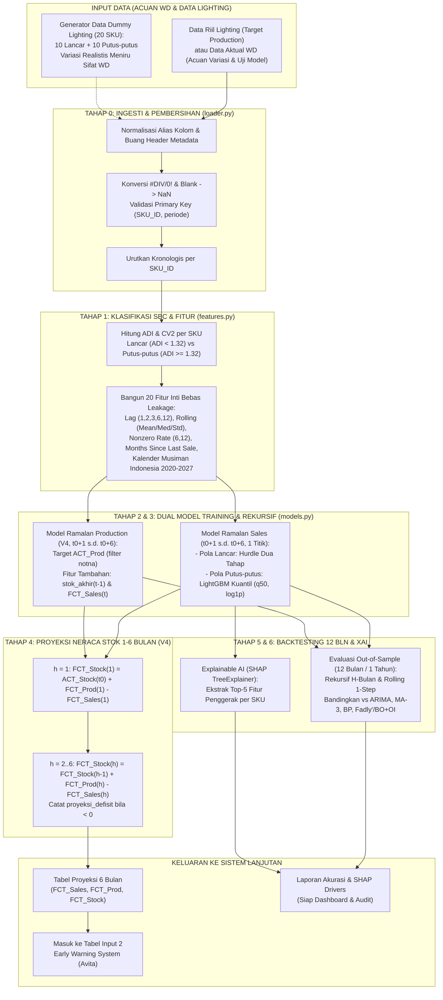
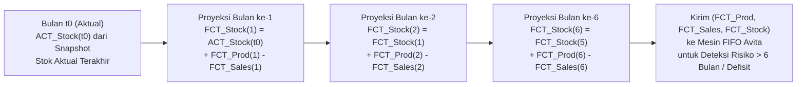

# Master Plan Lengkap: Sistem Ramalan Sales, Production, & Projected Stock (StockWise AI — Deka)

Dokumen ini merupakan panduan menyeluruh (*end-to-end*) modul **Demand, Production, & Stock Forecasting (Deka)** pada sistem **StockWise AI** (studi kasus **PT Panasonic Gobel Life Solutions Manufacturing Indonesia — Pabrik Cileungsi**), yang dirancang untuk memasok proyeksi `FCT_Sales`, `FCT_Prod`, dan `FCT_Stock` berhorizon 6 bulan langsung ke modul **Early Warning System (Avita)**.

---

## 1. Ringkasan Konsep & Spesifikasi Sistem

- **Tujuan Utama:** Menghasilkan ramalan **1 titik prediksi** untuk **Penjualan (`FCT_Sales`)**, **Produksi (`FCT_Prod`)**, dan **Proyeksi Stok (`FCT_Stock`)** per `SKU_ID` untuk **1 s.d. 6 bulan ke depan**, lengkap dengan penjelasan faktor penggerak berbasis **Explainable AI (SHAP)**.
- **Alasan Horizon 6 Bulan & Evaluasi 1 Tahun:**
  - Sesuai kesepakatan tim saat ini, definisi **deadstock** yang dipakai sistem adalah stok berumur **> 6 bulan**. Oleh karena itu, horizon ramalan ditetapkan **6 bulan** ($H = 6$) agar terhubung langsung ke modul *Early Warning System* (berbeda dari horizon 3 bulan yang sebelumnya dipakai untuk perencanaan material).
  - Evaluasi akurasi (*backtesting*) dirancang pada jendela evaluasi **1 tahun (`12` bulan)** (serta evaluasi *rolling 1-step* dan uji 6 bulan rekursif) untuk menangkap siklus musiman tahunan penuh (Ramadan/Lebaran & akhir tahun).
- **Pembagian 2 Aliran Model ML + 1 Turunan Neraca Stok:**
  1. **Model Ramalan Penjualan (`Sales` — 1 Titik Prediksi):** Dipilih berdasarkan klasifikasi pola permintaan *Syntetos–Boylan–Croston (SBC)* per SKU:
     - **Pola `Lancar`** ($\text{ADI} < 1{,}32$): **Hurdle Dua Tahap** *(pemenang empiris pada uji aktual V1–V3 dengan bias mendekati nol)*.
     - **Pola `Putus-putus`** ($\text{ADI} \ge 1{,}32$): **LightGBM Kuantil (`q50`)** pada skala `log1p` *(error terendah di segmen intermiten pada uji aktual V2–V3; hanya menghasilkan 1 titik prediksi median tanpa interval `q10`–`q90`)*.
     - **Pembanding (*Benchmark*):** `ARIMA`, `Rata-rata Bergerak (MA-3)`, `Business Plan (BP)`, serta prakiraan manusia/PIC bulan sebelumnya (`Fadly'` / `GSI+Fac`) *(catatan: `bo+OI` pada tanggal 26–28 akhir bulan merupakan rekap order menjelang tutup buku, bukan forecast awal bulan)*.
  2. **Model Ramalan Produksi (`ACT_Prod` — 1 Titik Prediksi):** *(Tahap integrasi V4)* Memprediksi realisasi produksi pabrik menggunakan histori `act_prod`, posisi stok bulan lalu (`stok_akhir_lag_1`), kalender, dan `FCT_Sales` hasil ramalan langkah yang sama, dengan `fct_prod` sebagai *benchmark*.
  3. **Turunan Proyeksi Stok (`FCT_Stock`):** Dihitung berantai untuk $h = 1 \dots 6$ menggunakan neraca stok:
     - Bulan ke-1 ($h = 1$): $\text{FCT\_Stock}(t_0+1) = \text{ACT\_Stock}(t_0) + \text{FCT\_Prod}(t_0+1) - \text{FCT\_Sales}(t_0+1)$
     - Bulan ke-$h$ ($h = 2 \dots 6$): $\text{FCT\_Stock}(t_0+h) = \text{FCT\_Stock}(t_0+h-1) + \text{FCT\_Prod}(t_0+h) - \text{FCT\_Sales}(t_0+h)$
- **Sumber Data, Strategi Dummy *Lighting*, & Target *Production*:**
  - **Referensi Aktual (*WD / Wiring Device* & *CP*):** Data aktual historis 2020–2025/2026 (`Sales`, `ACT_Prod`, `FCT_Prod`, `Stock`, `BP`, `STD`, `60%XSTD Min`, `Turn Over`, serta snapshot inventori terbaru) dipakai sebagai **acuan sifat variasi data nyata** sekaligus uji validasi model.
  - **Data Dummy *Lighting* (Sementara untuk Prototipe):** Karena data historis *Lighting* belum tersedia, akan dibuat **20 SKU dummy *Lighting*** (**10 SKU pola `Lancar`** + **10 SKU pola `Putus-putus`**). Generator dummy dirancang **tidak terlalu mulus** dan meniru karakteristik fluktuasi, rasio nol, variasi skala volume, dan dinamika stok pada data aktual **Wiring Device (WD)**.
  - **Target *Production* Sistem:** Pada implementasi produksi (*deployment* nyata), pipeline akan langsung mem-forecast **data riil *Lighting*** (begitu data riil *Lighting* masuk menggantikan data dummy).
  - **Verifikasi Literatur (Wajib sebelum sitasi resmi):** Batas `ADI = 1,32` & `CV² = 0,49` pada Syntetos, Boylan, & Croston (2005), FPP2 Bab 12.5, laporan pemenang VN2, dan makalah WSC 2017 perlu dibaca langsung oleh tim sebelum dikutip di laporan final.

---

## 2. Struktur Data Lengkap (Input & Output)

Pipeline menerima input dari file Excel di luar workspace ([StockWise_Template_Data_Aktual.xlsx](file:///c:/hackathon/train_model/templates/StockWise_Template_Data_Aktual.xlsx)) melalui argumen `--excel`, `--out-dir`, dan `--artifacts-dir` agar data aktual tetap privat.

### 2.1 Tabel Input 1 — Data Historis Bulanan (`1_Demand_Bulanan`)

- **Struktur Baris:** 1 baris = **1 `SKU_ID` pada 1 Bulan** (*primary key* unik: `(SKU_ID, periode)`).
- **Definisi Kolom:**

| Nama Kolom             | Tipe Data             |       Wajib?       | Sumber di Sheet Aktual                                   | Deskripsi & Penanganan Khusus                                                                                       |
| :--------------------- | :-------------------- | :-----------------: | :------------------------------------------------------- | :------------------------------------------------------------------------------------------------------------------ |
| `periode` / `DATE` | Date (`YYYY-MM-DD`) |         Ya         | Header Bulan (`Apr-20` $\rightarrow$ `2020-04-01`) | Tanggal awal bulan; otomatis diurutkan kronologis per SKU oleh `loader.py`.                                       |
| `SKU_ID`             | String                |         Ya         | `Item Code`                                            | Kode unik SKU *Finish Good*.                                                                                      |
| `nama_produk`        | String                |        Tidak        | Deskripsi Item                                           | Bila kosong otomatis diisi sama dengan `SKU_ID`.                                                                  |
| `kategori`           | String                |         Ya         | `Line`                                                 | Lini produksi / kelompok produk.                                                                                    |
| `jumlah_terjual`     | Float ($\ge 0$)     |         Ya         | `Sales`                                                | **Target utama ramalan penjualan.** Wajib bernilai `0` (bukan kosong) jika tidak ada penjualan.             |
| `act_prod`           | Float ($\ge 0$)     | Ya *(untuk Prod)* | `ACT Prod`                                             | **Target ramalan produksi.** Nilai kosong (`NaN`) difilter saat training agar tidak disamakan dengan `0`. |
| `fct_prod`           | Float ($\ge 0$)     |        Tidak        | `FCT Prod`                                             | Rencana produksi eksisting sebagai pembanding (*benchmark*).                                                      |
| `stok_akhir`         | Float ($\ge 0$)     |        Tidak        | `Stock`                                                | Saldo stok akhir bulan; hanya versi *lag* (`t-1`) yang dipakai sebagai fitur agar bebas *leakage*.            |
| `bp_sales`           | Float ($\ge 0$)     |        Tidak        | `BP`                                                   | Target *Business Plan* sebagai *benchmark* tambahan.                                                            |
| `fct_existing`       | Float ($\ge 0$)     |        Tidak        | `Fadly'` / `GSI+Fac` / `bo+OI`                     | Forecast pembanding; disarankan memakai forecast bulan sebelumnya (`Fadly'`/`GSI+Fac`) agar *apple-to-apple*. |
| `turn_over_hari`     | Float ($\ge 0$)     |        Tidak        | `Turn Over`                                            | Ketahanan stok (hari). Error `#DIV/0!` otomatis dikonversi ke `NaN`.                                            |

- **Contoh Baris Dummy (Pola Lancar & Putus-putus):**

|  `periode`  | `SKU_ID`    | `kategori` | `jumlah_terjual` | `act_prod` | `fct_prod` | `stok_akhir` | `bp_sales` | `fct_existing` |    `turn_over_hari` |
| :------------: | :------------ | :----------- | -----------------: | -----------: | -----------: | -------------: | -----------: | ---------------: | --------------------: |
| `2025-01-01` | `WD-DUM-01` | `Line-1`   |              1.250 |        1.400 |        1.300 |          1.850 |        1.500 |            1.200 |                  44,4 |
| `2025-02-01` | `WD-DUM-01` | `Line-1`   |              1.180 |        1.000 |        1.100 |          1.670 |        1.500 |            1.250 |                  42,5 |
| `2025-01-01` | `WD-DUM-02` | `Line-2`   |                  0 |            0 |            0 |            420 |           50 |               20 | `NaN` (`#DIV/0!`) |
| `2025-02-01` | `WD-DUM-02` | `Line-2`   |                160 |            0 |            0 |            260 |           50 |              100 |                  48,8 |

---

### 2.2 Tabel Input 2 — Snapshot Inventori Terkini (`2_Inventory_Snapshot`)

- **Struktur Baris:** 1 baris = **1 `SKU_ID` pada tanggal *cut-off* terakhir ($t_0$)**.
- **Definisi Kolom:**

| Nama Kolom           | Tipe Data             | Wajib? | Deskripsi & Fungsi                                                                    |
| :------------------- | :-------------------- | :----: | :------------------------------------------------------------------------------------ |
| `tanggal_snapshot` | Date (`YYYY-MM-DD`) |   Ya   | Tanggal posisi stok aktual terakhir ($t_0$).                                        |
| `SKU_ID`           | String                |   Ya   | Kode unik SKU (cocok dengan Tabel Input 1).                                           |
| `nama_produk`      | String                | Tidak | Nama item.                                                                            |
| `kategori`         | String                |   Ya   | Lini produksi (`Line`).                                                             |
| `lokasi_gudang`    | String                | Tidak | Lokasi gudang penyimpanan.                                                            |
| `stok_tersedia`    | Float ($\ge 0$)     |   Ya   | Menjadi titik awal `ACT_Stock(t0)` untuk proyeksi `FCT_Stock(t0+1)`.              |
| `safety_stock`     | Float ($\ge 0$)     |   Ya   | Batas stok minimum (dari `60%XSTD Min`).                                            |
| `reorder_point`    | Float ($\ge 0$)     | Tidak | Acuan `STD` perusahaan.                                                             |
| `umur_stok_hari`   | Float ($\ge 0$)     | Tidak | Nilai `Turn Over` (hari) terakhir (`#DIV/0!` otomatis menjadi `0` di snapshot). |

---

### 2.3 Tabel Output 1 — Proyeksi Sales, Production, & Stock 6 Bulan (`forecast_<periode>.csv`)

Tabel ini dirancang agar langsung dapat dikonsumsi oleh **Tabel Input 2 milik Avita (EWS)** maupun dashboard UI.

- **Struktur Baris:** 1 baris = **1 `SKU_ID` pada 1 Bulan Proyeksi** ($t_0+1 \dots t_0+6$).
- **Definisi Kolom:**

| Nama Kolom                           | Tipe Data             |   Status   | Deskripsi                                                                                                                             |
| :----------------------------------- | :-------------------- | :--------: | :------------------------------------------------------------------------------------------------------------------------------------ |
| `periode`                          | Date (`YYYY-MM-DD`) |  Tersedia  | Bulan proyeksi ($t_0+1 \dots t_0+6$).                                                                                               |
| `SKU_ID`                           | String                |  Tersedia  | Kode unik SKU (*Lighting* / *Finish Good*).                                                                                       |
| `kategori`                         | String                |  Tersedia  | Lini produksi / kategori (`Lighting` / `Line`).                                                                                   |
| `pola_sbc`                         | String                |  Tersedia  | Kategori permintaan: `Lancar` atau `Putus-putus` (`Smooth`, `Erratic`, `Intermittent`, `Lumpy`).                          |
| `model_terpilih`                   | String                |  Tersedia  | Model AI terpilih untuk `FCT_Sales` SKU tersebut.                                                                                   |
| `FCT_Sales` (`ramalan_terpilih`) | Float                 |  Tersedia  | **1 titik prediksi utama** penjualan bulan tersebut (langsung masuk ke `FCT_Sales` Avita; tanpa interval `q10`–`q90`). |
| `FCT_Prod` *(Target V4)*         | Float                 | Rencana V4 | **1 titik prediksi** realisasi produksi bulan tersebut (langsung masuk ke `FCT_Prod` Avita).                                |
| `FCT_Stock` *(Target V4)*        | Float                 | Rencana V4 | Proyeksi stok fisik akhir bulan $\max(0,\ \text{Stock}(t-1) + \text{FCT\_Prod}(t) - \text{FCT\_Sales}(t))$.                         |
| `proyeksi_defisit` *(Target V4)* | Float                 | Rencana V4 | Jumlah unit kekurangan bila $\text{Stock}(t-1) + \text{FCT\_Prod}(t) - \text{FCT\_Sales}(t) < 0$.                                   |

- **Contoh Baris Output Proyeksi (Dummy 20 SKU Lighting: 10 Lancar, 10 Putus-putus):**

|  `periode`  | `SKU_ID` | `pola_sbc`    | `model_terpilih`         | `FCT_Sales` | `FCT_Prod` | `FCT_Stock` | `proyeksi_defisit` |
| :------------: | :--------- | :-------------- | :------------------------- | ------------: | -----------: | ------------: | -------------------: |
| `2026-01-01` | `LGT-01` | `Lancar`      | `Hurdle Dua Tahap`       |         1.210 |        1.100 |         1.560 |                    0 |
| `2026-02-01` | `LGT-01` | `Lancar`      | `Hurdle Dua Tahap`       |         1.240 |        1.150 |         1.470 |                    0 |
| `2026-01-01` | `LGT-11` | `Putus-putus` | `LightGBM Kuantil (q50)` |            45 |            0 |           215 |                    0 |

---

### 2.4 Tabel Output 2 — Evaluasi Backtest & Explainable AI (`backtest_*.csv` & `shap_drivers_*.csv`)

- **`backtest_summary.csv` & `backtest_rolling_1step_summary.csv`:** Ringkasan `n_obs`, `MAE`, `RMSE`, `WAPE_pct`, `Cum_Bias_pct`, dan `Pinball_q50` per segmen (`Keseluruhan`, `Pola Lancar`, `Pola Putus-putus`).
- **`backtest_rolling_known_skus_summary.csv`:** Ringkasan backtest khusus SKU yang sudah memiliki histori di data latih (`ada_di_train == True`).
- **`shap_drivers_<periode>.csv`:** Top-5 fitur penggerak (`fitur`, `rata_rata_nilai_fitur`, `shap_kontribusi`, `arah_pengaruh`) per `SKU_ID` dari `shap.TreeExplainer`.

---

## 3. Diagram Alur Sistem (End-to-End)

### 3.1 Bagan Utama Pipeline Ramalan & Neraca Stok Proyeksi (Deka)

### 3.2 Alur Proyeksi Neraca Stok Rekursif (Bulan ke-1 s.d. ke-6)

---

## 4. Penjelasan Detail Proses per Tahap (Tahap 0 – Tahap 6)

### Tahap 0: Ingesti, Normalisasi, & Pembersihan Data ([src/loader.py](file:///c:/hackathon/train_model/src/loader.py))

- Membaca workbook Excel eksternal (`--excel`) dan memetakan alias kolom ke skema standar.
- Membuang baris metadata tipe data (baris ke-2 template) dan baris contoh bawaan.
- Mengonversi seluruh kolom numerik dengan `pd.to_numeric(..., errors="coerce")`, sehingga nilai error Excel seperti **`#DIV/0!`** di `turn_over_hari` dan sel kosong menjadi **`NaN`** tanpa merusak nilai `0` asli.
- Memvalidasi keunikan primary key `(SKU_ID, periode)` lalu mengurutkan kronologis per SKU.

### Tahap 1: Klasifikasi Pola Permintaan (SBC) & Rekayasa Fitur ([src/features.py](file:///c:/hackathon/train_model/src/features.py))

- **Klasifikasi SBC (dihitung hanya pada data latih saat *backtest* agar bebas *leakage*):**
  $$
  \text{ADI} = \frac{N_{\text{total}}}{N_{y > 0}}, \qquad \text{CV}^2 = \left(\frac{\sigma_{y > 0}}{\mu_{y > 0}}\right)^2
  $$

  - `ADI < 1,32` $\rightarrow$ **`Lancar`** (`Smooth` bila $\text{CV}^2 < 0{,}49$; `Erratic` bila $\ge 0{,}49$).
  - `ADI >= 1,32` $\rightarrow$ **`Putus-putus`** (`Intermittent` bila $\text{CV}^2 < 0{,}49$; `Lumpy` bila $\ge 0{,}49$).
- **20 Fitur Inti Aktif (untuk data aktual tanpa `harga`/`promo`):**
  - Identitas: `SKU_ID_cat`, `kategori_cat`.
  - Kalender otomatis (2020–2027): `bulan`, `sin_bulan`, `cos_bulan`, `hari_libur_bulan`, `is_musim_puncak` (mencakup `LEBARAN_PEAK_MONTHS` dan bulan `11–12`).
  - Histori bergeser (`shift(1)`): `lag_1`, `lag_2`, `lag_3`, `lag_6`, `lag_12`, `rolling_mean_3`, `rolling_mean_6`, `rolling_mean_12`, `rolling_median_6`, `rolling_std_3`, `nonzero_rate_6`, `nonzero_rate_12`, serta `months_since_last_sale` (jarak bulan sejak penjualan terakhir $> 0$).

### Tahap 2: Pemodelan Ramalan Penjualan (`Sales`) ([src/models.py](file:///c:/hackathon/train_model/src/models.py))

- **`TwoStageHurdleForecaster`** *(Andalan Empiris Pola `Lancar`)*:
  1. Tahap 1 (`LGBMClassifier`): memprediksi probabilitas kejadian $P(Y > 0 \mid X)$.
  2. Tahap 2 (`LGBMRegressor`): memprediksi $\log(1 + Y)$ khusus untuk $Y > 0$, lalu dikembalikan ke skala asli menggunakan *winsorized Duan smearing factor* (persentil residual `5%–95%`, diklip ke `[0.95, 1.25]`) untuk mencegah bias *Jensen's Inequality* tanpa meledak karena *outlier*.
- **`QuantileLGBMForecaster`** *(Andalan Empiris Pola `Putus-putus` — 1 Titik Prediksi)*:
  - Melatih model `LGBMRegressor(objective="quantile", alpha=0.50)` pada skala `log1p(y)` lalu dikembalikan dengan `expm1` untuk menghasilkan **1 titik prediksi median** (tanpa memakai interval ketidakpastian `q10`–`q90` pada output akhir).
- **Prediksi Multi-Bulan Rekursif (`recursive_ml_forecast`):**
  - Setiap langkah $t_0+h$ ($h = 1 \dots 6$), hasil ramalan bulan sebelumnya dimasukkan kembali sebagai `jumlah_terjual` untuk membentuk fitur `lag_*` dan `rolling_*` langkah berikutnya.

### Tahap 3: Pemodelan Ramalan Produksi (`ACT_Prod`) — *(Tahap Integrasi V4)*

- Target pelatihan adalah `act_prod` pada baris yang terisi (`act_prod.notna()`, memisahkan `0` produksi dari data kosong `NaN`).
- **Fitur Kunci Khusus Produksi:** Selain fitur lag `act_prod` (`prod_lag_1`, `prod_rolling_mean_3`) dan kalender, model produksi menerima:
  - **`stok_akhir(t-1)`**: bila stok bulan lalu sudah berlebih, produksi cenderung direm.
  - **`FCT_Sales(t)`**: proyeksi penjualan dari Tahap 2 pada bulan yang sama agar rencana produksi mengikuti kebutuhan permintaan.
- Diuji terhadap kolom `fct_prod` eksisting perusahaan pada *backtest* 12 bulan.

### Tahap 4: Proyeksi Neraca Stok (`FCT_Stock` 1–6 Bulan) — *(Tahap Integrasi V4)*

- Menggunakan titik awal `ACT_Stock(t0)` dari `2_Inventory_Snapshot` (atau `stok_akhir` bulan terakhir bila snapshot kosong).
- Menghitung `net_stock(h) = stock_prev + FCT_Prod(h) - FCT_Sales(h)` secara rekursif untuk $h = 1 \dots 6$.
- Jika `net_stock(h) < 0`, `FCT_Stock(h)` dibatasi minimal `0` dan selisih negatifnya dicatat pada `proyeksi_defisit(h)` (sesuai asumsi *lost sales* / sinyal defisit ke modul `Avita`).

### Tahap 5: Evaluasi *Backtesting* (Evaluasi 12 Bulan / 1 Tahun)

- Menggunakan metrik yang aman terhadap nilai `0` di pola *Putus-putus*:
  - **MAE** ($\text{mean}|y - \hat{y}|$), **RMSE** ($\sqrt{\text{mean}(y - \hat{y})^2}$), **WAPE** ($\frac{\sum |y - \hat{y}|}{\sum y} \times 100\%$), **Cum_Bias** ($\frac{\sum \hat{y} - \sum y}{\sum y} \times 100\%$), dan **Pinball Loss `q50`**.
- Menyajikan dua sudut uji: (1) **Rekursif multi-bulan** (menguji stabilitas rantai prediksi 6–12 bulan ke depan), dan (2) ***Rolling 1-step-ahead*** (menguji prediksi bulan `t` memakai histori aktual s.d. `t-1`), termasuk pemisahan evaluasi khusus SKU berhistori (`ada_di_train == True`).

### Tahap 6: Explainable AI (`compute_shap_drivers`)

- Menggunakan `shap.TreeExplainer` untuk mengekstrak `top_k = 5` fitur dengan kontribusi absolut tertinggi per `SKU_ID` beserta arah pengaruhnya (`Menaikkan` / `Menurunkan`) terhadap hasil ramalan.

---

## 5. Status Implementasi & Hasil Evaluasi Aktual (V1 – V3)

### 5.1 Ringkasan Hasil Uji pada Data Aktual WD (Iterasi V3, Backtest 6 Bulan)

Pada data aktual WD (total `5.712` observasi uji = `952` SKU $\times$ 6 bulan; `4.866` observasi merupakan SKU berhistori di data latih dan `141` SKU baru muncul di 6 bulan uji), hasil utama yang tercatat adalah:

| Segmen                                                 | Model AI Murni Terbaik (Teruji)            |   `WAPE_pct`   | `Cum_Bias_pct` | Pembanding `MA-3` (`WAPE_pct`) | Pembanding `BP` (`WAPE_pct`) |
| :----------------------------------------------------- | :----------------------------------------- | :--------------: | :--------------: | :--------------------------------: | :------------------------------: |
| **Keseluruhan (Rekursif 6 bln)**                 | **Hurdle Dua Tahap**                 | **45,26%** | **+5,45%** |               48,84%               |              89,64%              |
| **Pola Lancar (Rekursif 6 bln)**                 | **Hurdle Dua Tahap**                 | **39,25%** | **+0,61%** |               41,82%               |              89,04%              |
| **Pola Lancar (Rolling 1-step, SKU berhistori)** | **Hurdle Dua Tahap**                 | **42,71%** | **-1,98%** |               43,05%               |              89,01%              |
| **Pola Putus-putus (Rolling 1-step)**            | **LightGBM Kuantil (`q50` log1p)** | **65,00%** |     -38,34%     |               86,46%               |              95,29%              |

*Catatan Temuan Penting untuk Tim:*

1. **Routing Model Optimal:** Uji empiris membuktikan `Hurdle Dua Tahap` paling unggul dan hampir bebas bias pada **Pola Lancar**, sedangkan `LightGBM Kuantil (q50)` paling rendah error-nya pada **Pola Putus-putus** (kebalikan dari asumsi routing awal V1–V3).
2. **Klarifikasi `bo+OI` vs `Fadly'`:** Pada inspeksi sheet `Apr-25` & `Jun-25`, kolom `bo+OI` bertanggal `04/26/2025` dan `06/28/2025` (H-4/H-2 menjelang tutup buku, sehingga hampir identik dengan `Sales` aktual dengan `WAPE 25,15%`). Forecast manusia yang sebenarnya dibuat 1 bulan sebelumnya adalah kolom `Fadly'` (mis. `03/06/2025` untuk `Apr-25`, `05/08/2025` untuk `Jun-25`).

### 5.2 Checklist Kesiapan Menuju Integrasi Penuh (V4)

- **Sudah Selesai (V1–V3):**
  - Loader Excel privat (`--excel`, `--out-dir`, `--artifacts-dir`), pembersihan `#DIV/0!` & validasi primary key.
  - Klasifikasi SBC (`Lancar` vs `Putus-putus`), 20 fitur histori & kalender otomatis, model `Sales` (`Hurdle`, `Quantile`, `Tweedie`, `ARIMA`, `MA-3`), evaluasi rekursif + *rolling 1-step* + `SKU Berhistori`, dan `SHAP`.
- **Target Penyesuaian V4 (Agar 100% Sesuai Kontrak Deka $\rightarrow$ Avita):**
  1. Ubah default horizon menjadi `--forecast-months 6` (selaras definisi *deadstock* `> 6 bulan`) dan evaluasi default `--backtest-months 12` (1 tahun).
  2. Perbarui routing `ramalan_terpilih` `Sales` & `SHAP` menjadi `Hurdle Dua Tahap` (`Lancar`) dan `LightGBM Kuantil (q50)` (`Putus-putus`), serta hapus interval `q10`–`q90` dari keluaran utama agar fokus pada **1 titik prediksi**.
  3. Tambahkan modul ramalan **Production (`act_prod`)** untuk 1–6 bulan ke depan memakai fitur `stok_akhir_lag_1` & `FCT_Sales`, serta perhitungan berantai **`FCT_Stock(1..6)`** dan **`proyeksi_defisit`**.
  4. Buat generator **20 SKU dummy *Lighting*** (`10 Lancar` + `10 Putus-putus`) dengan sifat fluktuasi, *noise*, tingkat kejarangan (`ADI`), variasi skala, dan nilai kosong realistis yang meniru profil data aktual **WD (*Wiring Device*)** untuk pengujian sistem sebelum *deployment* pada **data riil *Lighting***.
